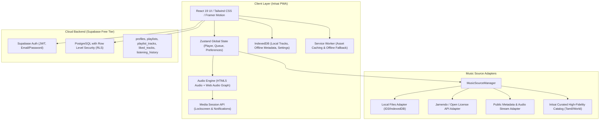

# InIsai (இனிசை) — Architecture & System Design Document
*Tagline: Every Beat, Your World.*

---

## 1. Executive Summary & Vision

**InIsai (இனிசை)** is a modern, responsive, installable Progressive Web Application (PWA) and music streaming platform. Built with a dark-first aesthetic inspired by Apple Music's fluid visual presentation and Spotify/BloomeeTunes' robust queue and provider-driven architecture, InIsai delivers seamless audio playback, personal library management, synchronized lyrics, and offline capabilities—engineered specifically to run under a **₹0 recurring infrastructure free-tier model**.

---

## 2. Comparative Reference Architecture Analysis

| Feature Area | BitChord (Android/Compose) | BloomeeTunes (Flutter/Rust) | InIsai (Next.js PWA / Web Audio) |
|---|---|---|---|
| **Platform** | Native Android | Cross-platform (Flutter + Rust) | PWA (Next.js App Router, React 19, TS, Tailwind) |
| **Design Language** | Apple Music minimalist blur, dynamic colors | Modern card grid, dark theme, tabbed navigation | Deep charcoal glassmorphism, Tamil typography accents, dynamic ambient album glow |
| **Audio Core** | ExoPlayer / Media3 | Rust audio pipeline + JustAudio | HTML5 Audio + Web Audio API (`AudioContext`, `BiquadFilterNode`, `AnalyserNode`) |
| **Queue Management** | In-memory queue with shuffle/repeat modes | State-managed queue with reorder & history | Zustand persistent store with queue reordering, shuffle bag, repeat-one/all, play-next |
| **Music Source Design**| Single provider (YouTube Music extraction) | Multi-source plugin architecture (JioSaavn, YouTube, local) | Multi-Source Adapter Pattern (`IMusicSourceAdapter`), cleanly separating metadata, search, and streaming |
| **Local Music** | MediaStore integration | Local file scanner & tag extractor | HTML5 File API + IndexedDB (`idb-keyval`) + client-side metadata reader |
| **Lyrics Engine** | LRC time-synced parser | LRC parser + Karaoke mode + offset adjustment | Custom high-precision LRC parser with smooth auto-scroll, active line glow, and time offset tuning |
| **PWA & Offline** | Not applicable (Native app) | Local cache file storage | Service Worker (Workbox / Cache API) + IndexedDB + Web App Manifest + Media Session API |
| **Backend & Sync** | Local-first / Scrobble (Last.fm) | Local SQLite | Supabase PostgreSQL + Row Level Security (RLS) + Supabase Auth |

---

## 3. System Architecture



---

## 4. Audio Engine & Web Audio Processing Graph

```mermaid
flowchart LR
    Source["HTML5 Audio Element (<audio>)"] --> MediaElementNode["MediaElementAudioSourceNode"]
    MediaElementNode --> BassFilter["Bass BiquadFilterNode (LowShelf @ 100Hz)"]
    BassFilter --> MidFilter["Mid BiquadFilterNode (Peaking @ 1kHz)"]
    MidFilter --> TrebleFilter["Treble BiquadFilterNode (HighShelf @ 8kHz)"]
    TrebleFilter --> PreGain["EQ / Crossfade GainNode"]
    PreGain --> Analyser["AnalyserNode (FFT Visualizer)"]
    Analyser --> Destination["AudioContext.destination (Speakers / Headphones)"]
```



### Key Audio Engine Capabilities:
1. **Gapless / Seamless Transitions**: Preloading upcoming track buffer and intelligent timeupdate tracking.
2. **5-Band Equalizer & Bass/Treble**: Real-time Parametric EQ processing using Web Audio API nodes without clipping.
3. **Crossfade**: Smooth gain ramp-down and ramp-up (configurable 0–12 seconds).
4. **Real-time Audio Visualizer**: 64-band frequency data sampled through `AnalyserNode` rendered on an HTML5 Canvas.
5. **Media Session API Integration**: Full background playback control, lockscreen metadata, dynamic album art, seek backwards/forwards, play, pause, next, previous.

---

## 5. Music Source Adapter Abstraction (`IMusicSourceAdapter`)

To strictly adhere to copyright and legal standards while maintaining maximum extensibility:
```typescript
export interface Track {
  id: string;
  title: string;
  artist: string;
  album?: string;
  duration: number; // in seconds
  artworkUrl: string;
  streamUrl: string;
  sourceType: 'local' | 'jamendo' | 'public_api' | 'curated';
  sourceId: string;
  lyricsUrl?: string;
  syncedLyrics?: string; // LRC formatted string
  language?: string;
  genre?: string;
  bitrate?: string;
  isPlayable: boolean;
}

export interface IMusicSourceAdapter {
  readonly id: string;
  readonly name: string;
  search(query: string, options?: { type?: 'all' | 'track' | 'artist' | 'album'; limit?: number }): Promise<Track[]>;
  getTrack(id: string): Promise<Track | null>;
  getStreamUrl(track: Track): Promise<string>;
  getLyrics?(track: Track): Promise<string | null>;
  isAvailable(): Promise<boolean>;
}
```

---

## 6. Database Schema & Supabase RLS

1. **`profiles`**: User profile attributes (display name, avatar, preferred language, theme).
2. **`playlists`**: User playlists with public/private visibility flags.
3. **`playlist_tracks`**: Junction table maintaining ordered tracks per playlist.
4. **`liked_tracks`**: Normalized user favorite tracks.
5. **`listening_history`**: User playback event logs with listened duration.
6. **`user_preferences`**: Audio quality, crossfade, EQ presets, volume, and playback configurations.

All tables are secured with Row Level Security (RLS) guaranteeing users can only read and mutate their own personal data, with public read access granted only to explicitly public playlists.

---

## 7. PWA & Offline Specification

- **Web App Manifest**: Full metadata, dark theme background `#090a0f`, theme color `#13151f`, standalone display mode, orientation `portrait-primary`, multiple high-DPI maskable icons.
- **Service Worker**: Stale-While-Revalidate caching for static assets, Cache-First for icons and web fonts, Network-First for dynamic API calls, and an offline fallback page.
- **PWA Installation Manager**: Listens to `beforeinstallprompt`, surfaces non-intrusive in-app install button/banner, guides iOS Safari users via Share > "Add to Home Screen".
- **Local Music & Offline Storage**: Local files parsed directly in the browser using HTML5 File API and metadata cached in IndexedDB.

---

## 8. Free-Tier Cost Control & Resource Strategy

1. **Zero Recurring Infrastructure**: Vercel Hobby ($0) + Supabase Free ($0) + GitHub ($0).
2. **Audio Bandwidth Protection**: Never proxy heavy audio streams through Next.js server functions; client connects directly to authorized audio origins or plays local device files.
3. **Storage Protection**: Audio files are never stored in PostgreSQL or Supabase Storage (which have strict free-tier quotas). User audio remains on client devices via IndexedDB.

